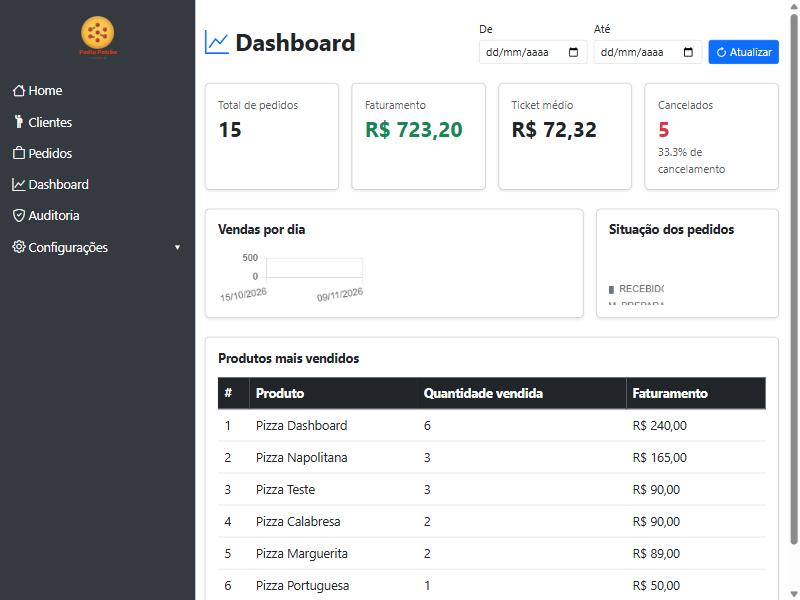
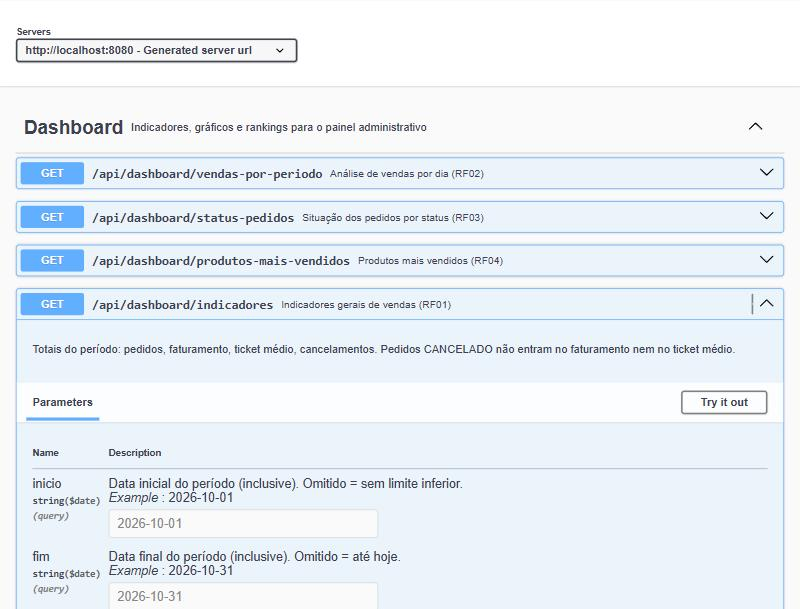
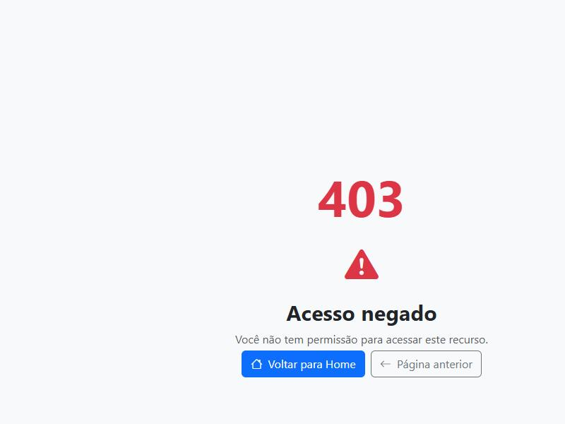

# Dashboard Administrativo — PediuPatrão

Documento da atividade "Dashboard Administrativo + API", construída em cima do sistema PediuPatrão já existente (branch `feature/dashboard-api`).

**Vídeo de demonstração (até 3 min):** [assistir](https://github.com/LucasMargenet/AtividadePizzaria/releases/download/dashboard-api-v1/PediuPatrao.Video.mp4) · [página da release](https://github.com/LucasMargenet/AtividadePizzaria/releases/tag/dashboard-api-v1)

## 1. Visão geral

O responsável pelo estabelecimento (perfis `ADMIN` e `GERENTE`) passa a ter um painel com indicadores de vendas, gráficos, situação dos pedidos e ranking de produtos, consumindo uma API REST própria (`/api/dashboard/**`) construída sobre os dados de pedidos já existentes no sistema — nenhuma coleção nova foi criada no MongoDB.

## 2. Requisitos funcionais

| # | Requisito | Como foi atendido |
|---|---|---|
| RF01 | Indicadores gerais de vendas | Cards no topo do dashboard: total de pedidos, faturamento, ticket médio, pedidos cancelados e taxa de cancelamento. `GET /api/dashboard/indicadores` |
| RF02 | Análise de vendas (gráficos) | Gráfico de linha com faturamento por dia no período. `GET /api/dashboard/vendas-por-periodo` |
| RF03 | Situação dos pedidos | Gráfico de rosca com a quantidade de pedidos em cada status do fluxo. `GET /api/dashboard/status-pedidos` |
| RF04 | Produtos mais vendidos | Tabela de ranking por quantidade vendida, com faturamento. `GET /api/dashboard/produtos-mais-vendidos` |
| RF05 | Filtros de consulta | Campos de data inicial/final no topo da tela, aplicados aos quatro endpoints acima |
| RF06 | Integração com a API | A tela `/dashboard` não acessa o banco diretamente: todo dado vem de `fetch` para a API REST própria |
| RF07 | Atualização e tratamento de dados | Botão "Atualizar", indicador de carregamento (`spinner`) e mensagem de erro amigável se a API falhar |

### Regra de negócio: o que conta como "venda"

Pedidos com status `CANCELADO` **não** entram no faturamento, no ticket médio, na análise por período nem no ranking de produtos — contam apenas no total geral de pedidos e na taxa de cancelamento. Essa decisão reflete o caixa esperado do estabelecimento.

## 3. Requisitos não funcionais

- **Segurança**: todos os endpoints do dashboard exigem autenticação e são restritos aos perfis `ADMIN` e `GERENTE` (`@PreAuthorize`), mesmo padrão já usado na auditoria do sistema. O perfil `ATENDENTE` recebe `403 Forbidden`, tanto na tela quanto na API.
- **Documentação**: endpoints documentados automaticamente via OpenAPI/Swagger (`springdoc-openapi`), disponível em `/swagger-ui/index.html` para qualquer usuário autenticado.
- **Desempenho**: as agregações rodam em memória (Java streams) sobre a consulta já filtrada por período no MongoDB — adequado ao volume de dados de uma pizzaria; não há necessidade de pipeline de agregação do banco neste estágio.
- **Usabilidade**: filtros de data persistem na tela entre atualizações; estados de carregamento e erro são sempre visíveis ao usuário, nunca uma tela em branco silenciosa.
- **Manutenibilidade**: regra de negócio isolada em `DashboardService`, testável sem subir banco de dados (testes de unidade com repositório mockado).

## 4. Arquitetura e decisões de projeto

- **Reaproveitamento do modelo de dados**: `Pedido` já guardava itens, status, valor total e datas (das atividades anteriores); o dashboard não exigiu nenhuma nova coleção, só uma consulta adicional (`findByDataHoraEntradaBetween`) no `PedidoRepository`.
- **Agregação em Java, não pipeline do MongoDB**: optei por buscar os pedidos do período e agregá-los com streams no `DashboardService`, em vez de um pipeline de `Aggregation` do MongoDB. Mais simples de ler, testar e explicar, e suficiente para o volume de dados do domínio.
- **DTOs de resposta dedicados**: cada endpoint tem seu próprio DTO (`IndicadoresGeraisDTO`, `VendaPeriodoDTO`, `StatusPedidoCountDTO`, `ProdutoMaisVendidoDTO`), evitando expor a entidade `Pedido` diretamente na API.
- **Autorização em profundidade**: a restrição a `ADMIN`/`GERENTE` existe tanto na rota web (`HomeController`) quanto na API (`DashboardController`) — ocultar o link no menu não seria suficiente, então o backend é quem efetivamente barra o acesso.

## 5. Documentação dos endpoints

Base URL local: `http://localhost:8080`. Todos exigem sessão autenticada com perfil `ADMIN` ou `GERENTE`. Documentação interativa completa (com "Try it out") em `/swagger-ui/index.html`; schema OpenAPI cru em `/v3/api-docs`.

### `GET /api/dashboard/indicadores`

Indicadores gerais do período.

**Parâmetros (query, opcionais):**

| Nome | Tipo | Descrição |
|---|---|---|
| `inicio` | `date` (ISO `yyyy-MM-dd`) | Data inicial (inclusive). Omitido = sem limite inferior |
| `fim` | `date` (ISO `yyyy-MM-dd`) | Data final (inclusive). Omitido = até hoje |

**Exemplo de requisição:**
```
GET /api/dashboard/indicadores?inicio=2026-10-01&fim=2026-11-09
```

**Exemplo de resposta (200 OK):**
```json
{
    "totalPedidos": 15,
    "pedidosFinalizados": 5,
    "pedidosCancelados": 5,
    "taxaCancelamento": 33.333333333333336,
    "faturamentoTotal": 723.2,
    "ticketMedio": 72.32000000000001
}
```

### `GET /api/dashboard/vendas-por-periodo`

Série de faturamento e quantidade de pedidos por dia, para o gráfico (RF02). Mesmos parâmetros `inicio`/`fim`.

**Exemplo de resposta (200 OK):**
```json
[
    { "data": "2026-10-15", "quantidadePedidos": 3, "faturamento": 166.5 },
    { "data": "2026-10-16", "quantidadePedidos": 4, "faturamento": 316.7 },
    { "data": "2026-11-09", "quantidadePedidos": 3, "faturamento": 240.0 }
]
```

### `GET /api/dashboard/status-pedidos`

Quantidade de pedidos por status no período (RF03). Mesmos parâmetros `inicio`/`fim`. Todos os status são sempre retornados, mesmo com contagem zero.

**Exemplo de resposta (200 OK):**
```json
[
    { "status": "RECEBIDO", "quantidade": 3 },
    { "status": "EM_PREPARACAO", "quantidade": 1 },
    { "status": "PRONTO", "quantidade": 0 },
    { "status": "SAIU_PARA_ENTREGA_RETIRADO", "quantidade": 1 },
    { "status": "FINALIZADO", "quantidade": 5 },
    { "status": "CANCELADO", "quantidade": 5 }
]
```

### `GET /api/dashboard/produtos-mais-vendidos`

Ranking de produtos por quantidade vendida (RF04).

**Parâmetros (query):**

| Nome | Tipo | Obrigatório | Descrição |
|---|---|---|---|
| `inicio` | `date` | Não | Data inicial (inclusive) |
| `fim` | `date` | Não | Data final (inclusive) |
| `limite` | `int` | Não (padrão 10) | Quantidade máxima de produtos no ranking, deve ser ≥ 1 |

**Exemplo de requisição:**
```
GET /api/dashboard/produtos-mais-vendidos?limite=3
```

**Exemplo de resposta (200 OK):**
```json
[
    { "produtoId": "6af262d6f6fb9e1bce51cfd7", "nomeProduto": "Pizza Dashboard", "quantidadeVendida": 6, "faturamento": 240.0 },
    { "produtoId": "6ad2123869e62f1198bee3d7", "nomeProduto": "Pizza Napolitana", "quantidadeVendida": 3, "faturamento": 165.0 },
    { "produtoId": "6ad26a667e77704bed1b6793", "nomeProduto": "Pizza Teste", "quantidadeVendida": 3, "faturamento": 90.0 }
]
```

### Erros possíveis (comuns aos 4 endpoints)

| Status | Quando acontece | Exemplo de corpo |
|---|---|---|
| `302` (redireciona ao login) | Usuário não autenticado tentando acessar via navegador | — |
| `401 Unauthorized` | Requisição sem sessão válida (ex: chamada direta de API sem login) | — |
| `403 Forbidden` | Autenticado, mas com perfil `ATENDENTE` | `{"timestamp":"...","status":403,"error":"Forbidden","path":"/api/dashboard/indicadores"}` |
| `400 Bad Request` | Parâmetro `limite` menor que 1 (só em `produtos-mais-vendidos`) | `{"erro":"O parâmetro 'limite' deve ser maior ou igual a 1."}` |

## 6. Evidências de teste

### 6.1 Testes automatizados

7 testes automatizados (JUnit 5 + Mockito + MockMvc), cobrindo a regra de negócio do `DashboardService` e a autorização/validação do `DashboardController`:

```
Test set: com.umc.pediupatrao.controller.DashboardControllerTest
Tests run: 3, Failures: 0, Errors: 0, Skipped: 0

Test set: com.umc.pediupatrao.service.DashboardServiceTest
Tests run: 4, Failures: 0, Errors: 0, Skipped: 0
```

Cobrem: faturamento excluindo pedidos cancelados, cálculo de ticket médio (incluindo o caso de lista vazia, sem divisão por zero), agrupamento de vendas por dia, ranking de produtos mais vendidos, GERENTE e ATENDENTE acessando a API (200 e 403, respectivamente) e validação do parâmetro `limite` (400).

Reprodução: `./mvnw test`

### 6.2 Testes manuais (API)

Requisições reais contra a aplicação rodando localmente, autenticado como `gerente01`:

- `GET /api/dashboard/indicadores` → `200`, resposta no [item 5](#get-apidashboardindicadores)
- `GET /api/dashboard/vendas-por-periodo` → `200`, resposta no item 5
- `GET /api/dashboard/status-pedidos` → `200`, resposta no item 5
- `GET /api/dashboard/produtos-mais-vendidos?limite=3` → `200`, resposta no item 5
- `GET /api/dashboard/indicadores` autenticado como `atendente01` → `403 Forbidden`
- `GET /api/dashboard/produtos-mais-vendidos?limite=0` → `400`, `{"erro":"O parâmetro 'limite' deve ser maior ou igual a 1."}`

### 6.3 Evidências visuais

**Dashboard funcional (perfil GERENTE), com indicadores, gráficos e ranking populados:**



**Documentação automática dos endpoints no Swagger, incluindo parâmetros e exemplos:**



**Acesso negado ao perfil ATENDENTE (prova de autorização no backend, não apenas ocultação de botão):**



## 7. Como executar e testar

```bash
docker compose up -d        # MongoDB local
./mvnw spring-boot:run       # aplicação em http://localhost:8080
```

Usuários de teste (senha `teste123` para todos): `admin` (ADMIN), `gerente01` (GERENTE), `atendente01` (ATENDENTE, sem acesso ao dashboard).

- Dashboard: `http://localhost:8080/dashboard`
- Documentação interativa (Swagger): `http://localhost:8080/swagger-ui/index.html`
- Testes automatizados: `./mvnw test`
